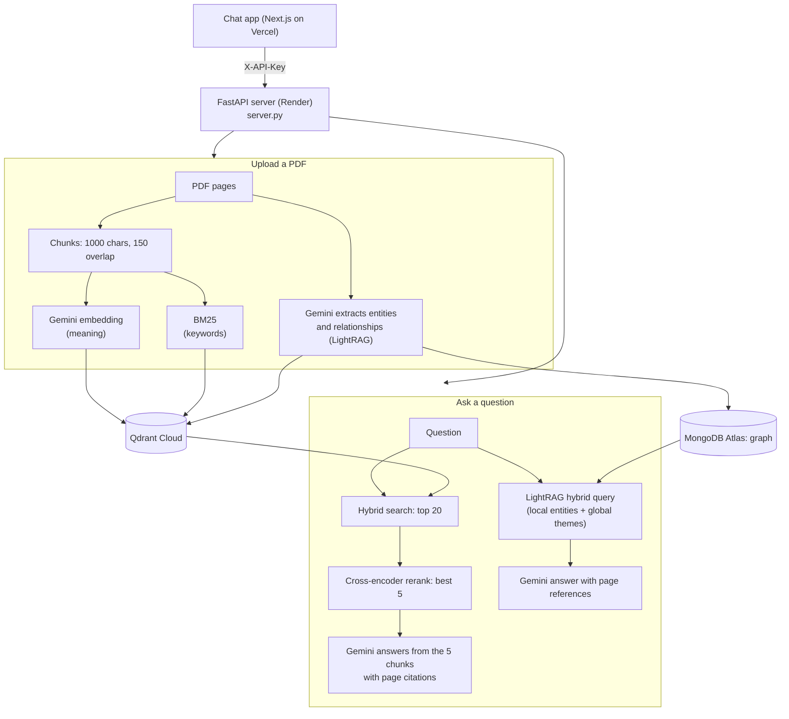

# rag-backend

Python FastAPI service behind the [Gemini RAG Assistant](https://github.com/deekshithlanka/Gemini-AI-Chat)
(live: https://gemini-ai-chat-coral.vercel.app). It turns PDFs into searchable knowledge and answers questions
with page citations, using two retrieval modes: a **vector database** and a **knowledge graph**.

## Architecture



## Endpoints
| Method | Path | Purpose |
|---|---|---|
| GET | `/health` | Status and peak memory (no password needed) |
| POST | `/chat` | `{"messages": [...], "rerank": true}` -> `{"text", "sources", "reranked"}` |
| POST | `/ingest` | Upload a PDF (field `file`) into the vector DB |
| POST | `/kg/chat` | Answer from the knowledge graph |
| POST | `/kg/ingest` | Build the knowledge graph from a PDF (background) |
| GET | `/kg/status` | Progress of the current graph build |

All endpoints except `/health` require the `X-API-Key` header when `RAG_API_KEY` is set.

## Files
- `rag.py`: ingest, hybrid search, reranking, answers (also a command line: `embed`, `ingest`, `reindex`, `search`, `ask`)
- `kg.py`: LightRAG knowledge graph with Gemini
- `server.py`: FastAPI endpoints, validation, API key
- `render.yaml`, `.python-version`: Render deployment (Python 3.12, free plan)

## Run locally (Mac)
```bash
python3 -m venv .venv && source .venv/bin/activate
pip install -r requirements.txt
cp .env.example .env    # GOOGLE_API_KEY; optional QDRANT_URL, QDRANT_API_KEY, MONGO_URI
uvicorn server:app --port 8001
```
Without `QDRANT_URL` / `MONGO_URI`, data is stored locally in `qdrant_data/` and `lightrag_data/`.

## Settings
| Variable | Purpose |
|---|---|
| `GOOGLE_API_KEY` | Gemini embeddings, answers, graph extraction |
| `QDRANT_URL`, `QDRANT_API_KEY` | Qdrant Cloud (vectors) |
| `MONGO_URI` | MongoDB Atlas (knowledge graph) |
| `RAG_API_KEY` | Password callers must send |
| `RERANK_MODEL` | Reranker (default `Xenova/ms-marco-MiniLM-L-12-v2`; L-6 on Render to save memory) |
| `CHAT_MODEL`, `KG_MODEL` | Gemini models for answers and graph extraction |
